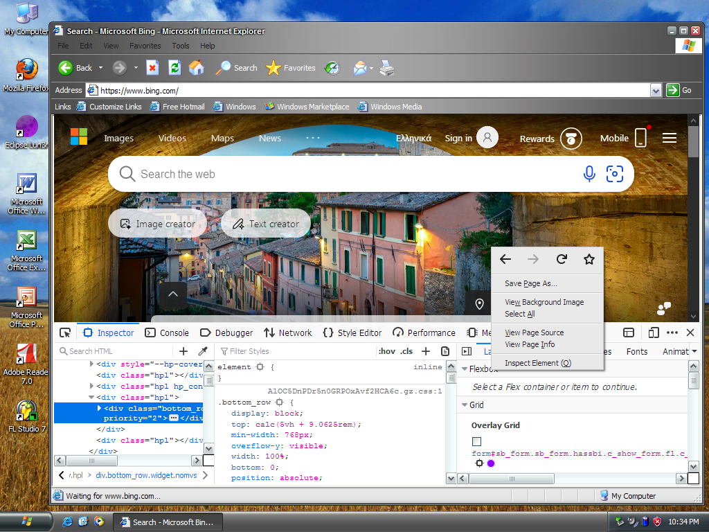

# GeckoIE

Hi! So GeckoIE is a project aiming to port Firefox's Gecko engine into Internet Explorer 6(+ down the line).

> Alpha stage, so expect bugs.

## How It Works

Right now, the project is in a super early stage that basically just docks a toolbar-less Mypal (or whatever firefox related) window into an IE window. The goal is to get a full, raw Engine port, that will rendered natively inside IE Shell. 

An IE addon starts the Gecko engine inside Internet Explorer's own process. IE shows a native document view, and the engine window is inside that view.

It's still a Gecko window placed inside Internet Explorer's view, not the core engine port, but in a much better way than just docking a whole browser window (like Firefox) on IE.

## Status
 
The project is split into four stages. It is currently in stage 2.
 
| Stage | State | What it means |
|---|---|---|
| 1. Window hosted prototype | Done | A Mypal (74.1.4) window was docked over IE's page area. |
| 2. Synced browser shell | Mostly done | Engine runs inside IE view. Addressbar, title, history, favs, back/fwd, context-menu + work, Still in experimental mode. |
| 3. Raw engine port | Research | The goal is Gecko drawing directly inside IE with no child window at all. Not started yet. (it's gonna take a long time)|
| Final. Optimizations | Planned | Severely decrease disk usage, lowering RAM usage and background processes. |
 
> Used Mypal 74.1.4. GeckoIE does not change Mypal's program files.

## Compatibility Info

- Target: **Windows XPx86 running Internet Explorer 6.** This is the only combination that is actually tested.
- Everything else is experimental. Later versions of IE OR mypal OR firefox or Windows will cause crashes, and they are not the main focus. Basic compatibility optimizations have been done though not guaranteed.

|                |Internet Explorer v.                         |Windows v.                         |
|----------------|-------------------------------|-----------------------------|
|Works (tested)|6           |XP            |
|Experimental|7,8 (for XP)          |XP            |
|Nightly (mostly not working)          |7+            |Vista and up            |

## Requirements
 
- Windows XP, 32-bit, with Internet Explorer 6.
- **.NET Framework 2.0 or newer.** The installer builds the IE add-on on your PC with the .NET compiler.
- A copy of Mypal / Firefox folder that works on XP. GeckoIE does not include Mypal. Mypal's source: <https://github.com/Feodor2/Mypal68>. Folder must contain **xul.dll** and either **firefox.exe** or **mypal.exe**.
- 200 MB of disk space, or less if you select the slim option.

## How to install

- Download a version of Firefox based browser that works on XP, recommend [Mypal](https://www.mypal-browser.org/download.html). (Mypal 74.1.4 is the most stable one for this moment).
- Download the setup file from Releases. 
- Run setup, it will ask you for:
  - Where to install GeckoIE
  - Where you have your browser folder with firefox.exe
  - Which components you want:
    - PDF viewer, media playback (H.264/AAC), spell-check dictionaries, performance tuning and the toolbar button are on by default.
    - Dev tools.
    - Remove unused files.
- Run Internet Explorer 6 and expect bugs.
> - You can still run legacy IE6 engine either through the Start menu shortcut or just by disabling the addon.

## Using it
- Easy, i guess just browse.
- **GeckoIE Settings.** is a window where you choose:
  - the homescreen: a white blank page (default) or a "Loading" screen while the engine starts,
  - who handles downloads (see below),
  - what the right-click menu shows and in which order.
- **Downloads**: the engine downloads the file and Internet Explorer then opens it with its normal File Download window. The setting can be switched to a plain "Save As" window handled by GeckoIE.
- **Settings** you do not change in the window live in ieb.ini in the install folder: turn the engine off (Enabled=0), turn off starting it early (Prewarm=0), change its CPU priority (Priority) or put a soft cap on its memory (MaxWorkingSetMB). Changes apply the next time the engine starts. The settings window saves your choices separately for each Windows user.

## Troubleshooting
- IE shows ordinary pages and never the engine: check Enabled=1 in ieb.ini, and that the add-on is enabled in IE's Tools > Manage Add-ons.
- The engine was slimmed too much: run restore-engine.bat from the install folder.

# AN IMPORTANT NOTE ON AI
I want to be transparent: Most of this project was built using Claude AI, guided by me and my super clever instructions logic... (hehe) So that means that unexpected bugs WILL happen. If u trust AI, then you might be ok with this project, If not... well, fair enough :) I am not super active now but I will work on that.

## Screenshots
Here are some early Alpha screenshots:

  

## Known issues
 
- The first start of IE (not first ever launch, but first after reboot) is gonna be slow, so real hardware slow disks are gonna take 30s+. 
- Back/Fwd load the previous page again, so the scroll position is lost.
- Some pages display a **gie:** address in IE's address bar, because IE believes that is the page's address, and most of the **favorites** too.
- Save Page As saves only the page's HTML, not images or styles.
- javascript: bookmarks in favorites do not run on engine pages.
- Downloads go through the engine first, so there is no IE progress window, only progress text in IE's status bar.
- DevTools / Inspect Element might not work at all.

## Credits and legal
 
- [Mypal](https://github.com/Feodor2/Mypal) by Feodor2, and Gecko by Mozilla, both under the Mozilla Public License 2.0.
- NSIS (Nullsoft Scriptable Install System).
- GeckoIE is an independent project. It is not affiliated with, endorsed by or sponsored by Microsoft or Mozilla. "Internet Explorer" and "Firefox" are trademarks of their owners.
- License for GeckoIE's own code: *choose one before publishing (for example MIT or MPL-2.0).*
